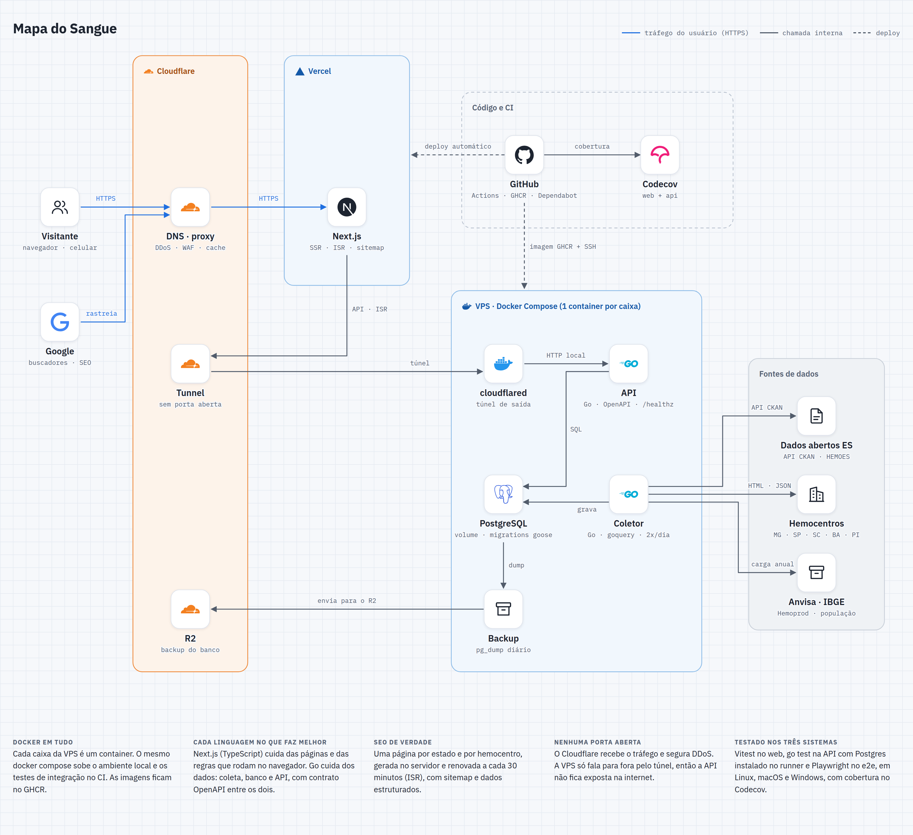

# System design



Fonte editável: [arquitetura.src.html](arquitetura.src.html). Para gerar de novo o HTML e o PNG, use a skill `diagrama-system-design`.

## Decisões

| Decisão | Escolha | Por quê | Alternativa descartada |
|---|---|---|---|
| Front | Next.js (App Router) na Vercel | SEO com páginas geradas no servidor e ISR, deploy nativo e gratuito | Vue + Vite (só renderiza no navegador, SEO fraco) |
| API e coleta | Go (`net/http`, `pgx`, `goquery`) | Biblioteca padrão resolve HTTP, testes e cobertura. Compila rápido nos 3 sistemas do CI. Curva menor que Rust para o grupo | Rust (compila devagar no CI e é mais difícil de aprender no prazo) |
| Banco | PostgreSQL na VPS | Um banco só para leituras, histórico e estatísticas. Roda junto da API, sem latência | D1/SQLite (bom, mas a API saiu do Cloudflare) |
| Borda | Cloudflare (plano gratuito) | DNS do domínio, proteção DDoS, WAF e cache. O Tunnel liga a VPS sem abrir porta | Expor a VPS direto (porta aberta, sem proteção) |
| Servidor | VPS com Docker Compose | API, coletor e Postgres juntos, custo previsível | Render gratuito (dorme após 15 min) |
| Backup | `pg_dump` diário para Cloudflare R2 | 10 GB grátis, sem custo de saída | Sem backup |

### Atenção ao enunciado do TP

O TP pede deploy em "plataforma de nuvem com plano gratuito". O site (Next.js) fica na Vercel, que é gratuita. Para a VPS da API seguir a mesma regra, a sugestão é a **Oracle Cloud Always Free** (VPS ARM gratuita sem prazo). Uma VPS paga (Hetzner, Contabo) pode entrar depois, sem mudar nada no código, porque tudo roda em Docker Compose.

## Docker em todos os ambientes

| Ambiente | Como roda |
|---|---|
| Desenvolvimento | `make dev` sobe `compose.yaml`: Postgres, API com recarga automática (air), coletor sob demanda e web (`next dev`) |
| Testes de integração | `compose.test.yaml` sobe Postgres e API limpos; o job de Linux do CI roda a API real e o e2e contra eles |
| Produção (VPS) | `compose.prod.yaml` com as imagens do GHCR: `api`, `coletor` (timer), `postgres`, `backup` e `cloudflared` |
| Web | Na Vercel por padrão; o `web/Dockerfile` (saída `standalone` do Next) permite rodar o site também na VPS |

Imagens: build em várias etapas, rodando como usuário sem privilégio, com `HEALTHCHECK`. A API usa imagem `distroless` (só o binário). O `hadolint` verifica os Dockerfiles e o Trivy procura vulnerabilidades nas imagens.

Limite do GitHub Actions: os runners de macOS e Windows não têm Docker. Por isso o CI faz assim:
- **Linux**: tudo em Docker (integração com `compose.test.yaml` e e2e)
- **Linux, macOS e Windows**: testes de unidade e cobertura nativos, com Postgres instalado no runner pela action `ikalnytskyi/action-setup-postgres`. É isso que o TP exige

## O que os projetos de referência têm e entra aqui

Comparação com [go-clean-template](https://github.com/evrone/go-clean-template), [wild-workouts](https://github.com/ThreeDotsLabs/wild-workouts-go-ddd-example), [cal.com](https://github.com/calcom/cal.com), [umami](https://github.com/umami-software/umami), [dub](https://github.com/dubinc/dub) e [plausible](https://github.com/plausible/analytics).

**P0: entra agora, faz parte do TP ou sustenta o resto**

- Docker em todos os ambientes (seção acima), `.dockerignore`
- `Makefile` com os comandos do projeto (`make dev`, `make test`, `make lint`, `make migrate`)
- Configuração por variável de ambiente, com `.env.example` e validação na inicialização
- Contrato OpenAPI (`api/openapi.yaml`): o servidor Go é gerado com `oapi-codegen` e o cliente TypeScript com `openapi-typescript`. Um teste de contrato garante que a API responde o que o contrato diz
- Migrations com `goose`, validadas no CI
- Lint e formatação: `golangci-lint` (Go) e Biome (TypeScript)
- Ganchos de pré-commit com `lefthook` (lint, formatação, mensagem no padrão Conventional Commits)
- `/healthz` e `/readyz`, desligamento sem perder requisições, timeouts e logs estruturados (`slog`)
- Erros no formato padrão RFC 9457 (`application/problem+json`)
- Segurança na API: CORS restrito ao domínio, cabeçalhos de segurança, limite de requisições no `POST /doacoes`

**P1: qualidade que pesa na nota de testes e no portfólio**

- Testes de acessibilidade com `axe-core` no Playwright
- Lighthouse CI com metas de SEO, desempenho e acessibilidade
- Testes de mutação (Stryker no TypeScript, gremlins no Go): mostram se os testes pegam bugs de verdade, e não só se executam as linhas
- Segurança no CI: CodeQL, `govulncheck`, `gitleaks` (segredos no código), Trivy (imagens)
- Dependabot também para `gomod` e `docker`
- `CONTRIBUTING.md`, `SECURITY.md`, `CODE_OF_CONDUCT.md`, modelos de issue e PR, `CODEOWNERS`
- Proteção da branch `main` com os checks obrigatórios
- Decisões registradas em `docs/adr/`

**P2: depois da entrega**

- Monitor de disponibilidade (UptimeRobot, gratuito) e rastreio de erros (Sentry, plano gratuito)
- Métricas com Prometheus e Grafana
- Teste de carga com k6
- Versões e changelog automáticos com release-please
- Restauração do backup testada periodicamente

## Estrutura do repositório

```
mapa-do-sangue/
├── web/                    Next.js: páginas, componentes, regras do navegador
│   ├── app/                rotas: /, /estado/[uf], /hemocentro/[id], /posso-doar, sitemap, robots
│   ├── lib/domain/         regras de doação, compatibilidade, níveis (TypeScript puro)
│   ├── lib/api/            cliente gerado do OpenAPI
│   ├── tests/              Vitest + Testing Library; e2e com Playwright
│   └── Dockerfile
├── api/                    Go: API HTTP, coletor e importador
│   ├── openapi.yaml        contrato da API (fonte única)
│   ├── cmd/api/            servidor HTTP
│   ├── cmd/coletor/        coleta das fontes
│   ├── cmd/importar/       carga anual Anvisa + IBGE
│   ├── internal/config/    variáveis de ambiente validadas
│   ├── internal/dominio/   tipos, níveis, escalas
│   ├── internal/fontes/    um leitor por hemocentro + testdata/ com as páginas salvas
│   ├── internal/store/     consultas Postgres (pgx)
│   ├── internal/http/      handlers, middlewares (CORS, limite, logs)
│   ├── migrations/         SQL versionado (goose)
│   └── Dockerfile
├── deploy/                 compose.prod.yaml, cloudflared, backup
├── compose.yaml            ambiente local
├── compose.test.yaml       testes de integração
├── Makefile
├── .env.example
├── lefthook.yml
└── docs/                   pesquisa, design e adr/
```

## Contrato da API (v1)

| Método | Rota | Resposta |
|---|---|---|
| GET | `/v1/estoque` | estoque atual de cada hemocentro, com histórico de dias críticos |
| GET | `/v1/estoque/{uf}` | o mesmo, filtrado por estado |
| GET | `/v1/estatisticas` | coletas por mil habitantes por estado (Anvisa + IBGE) |
| GET | `/v1/doacoes/mes` | total de doações registradas no mês |
| POST | `/v1/doacoes` | registra doação (só UF e tipo, sem dado pessoal) |

## Estratégia de testes

| Camada | Ferramenta | O que cobre |
|---|---|---|
| Regras do navegador | Vitest | elegibilidade, compatibilidade, formatação |
| Componentes | Vitest + Testing Library | formulários, painel, estados de erro |
| Leitores das fontes | `go test` + fixtures | cada página real salva, sem internet |
| Banco e API | `go test` + Postgres no runner | consultas, validação, rotas HTTP |
| Fluxo completo | Playwright | página inicial, filtro, quiz, registro de doação |

Cobertura: Vitest (v8) e `go test -coverprofile`, enviadas ao Codecov com as flags `web` e `api`. O CI roda tudo em Linux, macOS e Windows. O Postgres é instalado no runner pela action `ikalnytskyi/action-setup-postgres`, porque macOS e Windows não têm Docker no GitHub Actions.

## O que vem da versão atual

A versão em Vue + Cloudflare D1 já validou as fontes e as regras. Na migração:

- `src/domain` (regras de doação, compatibilidade, níveis, datas) vai para `web/lib/domain` quase sem mudança, com os testes
- os 6 leitores de fonte e a coleta são reescritos em Go, com as mesmas fixtures e os mesmos casos de teste
- o schema SQL passa para Postgres
- as estatísticas da Anvisa e do IBGE viram o comando `importar`
